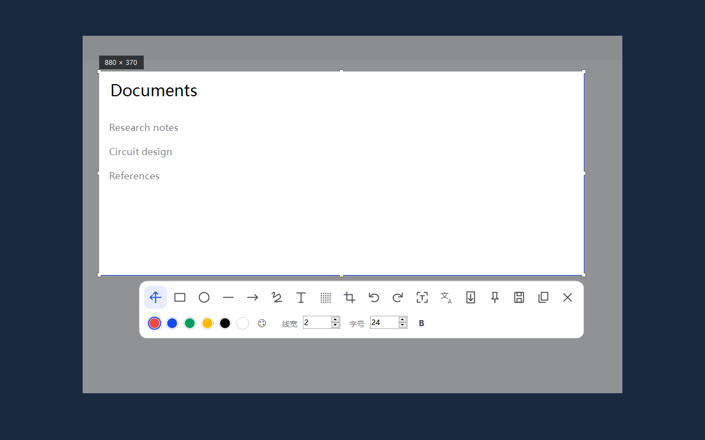
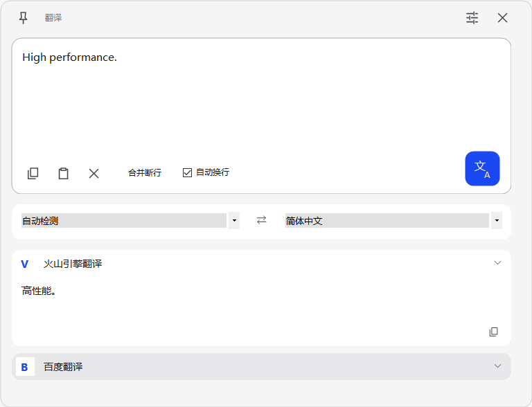
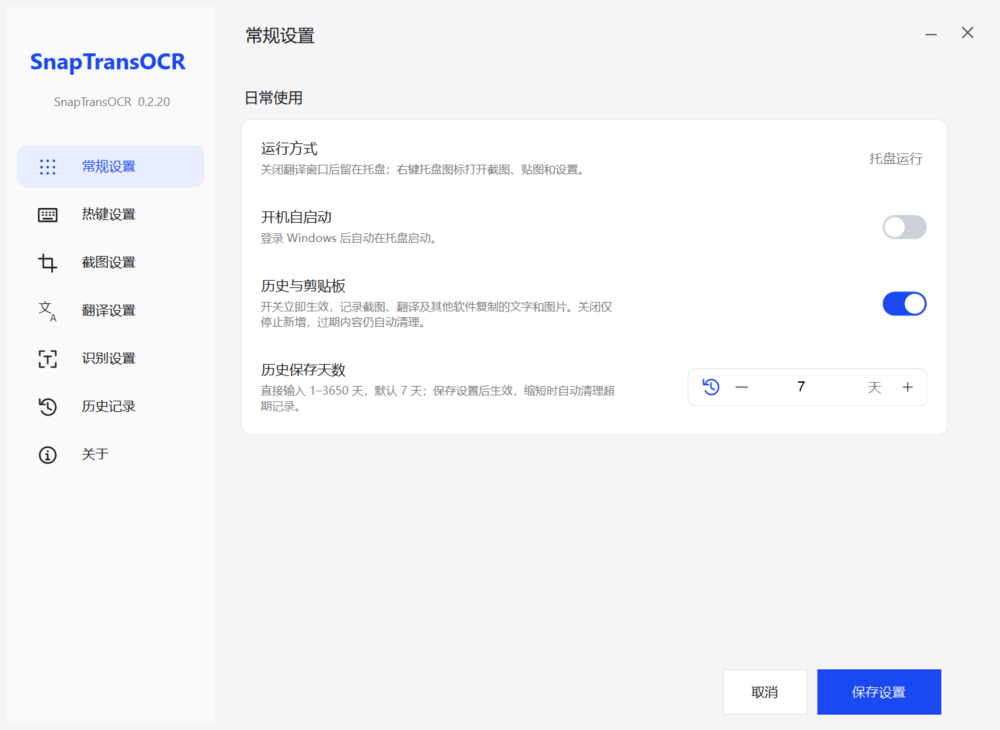

<p align="center"></p>

# SnapTransOCR

轻量的 Windows 截图、标注、OCR、截图翻译、划词翻译与剪贴板历史工具。

使用 C# / Win32 / Windows Forms 实现，不打包浏览器内核和本地 OCR 模型。当前版本 **0.2.20**，原名轻截 QingSnap。

**[下载最新版](https://github.com/Greg-Street/SnapTransOCR/releases/latest) · [完整使用说明](docs/USAGE.md) · [反馈问题](https://github.com/Greg-Street/SnapTransOCR/issues)**

## 界面预览

截图与标注：



<p align="center"></p>

0.2.20 常规设置：历史保存期限支持直接输入 1–3650 天，默认 7 天。



以上均为程序界面示例；设置页来自 0.2.20，其余功能图用于展示交互，不含个人配置。

## 功能

- **截图与标注**：矩形、椭圆、箭头、画笔、文字、马赛克、裁剪、撤销与重做。
- **OCR**：百度与腾讯云文字识别，支持复制、编辑及继续翻译；已接入的专项接口见使用说明。
- **翻译**：火山引擎、百度、必应，以及可配置的豆包 / Ark 服务。
- **图片原位翻译与贴图**：保留原图 / 译图切换、缩放、文字选择和复制。
- **划词翻译**：选中文字后按快捷键触发，不常驻显示划词按钮。
- **历史与剪贴板**：文字、图片、OCR 和翻译记录，可搜索、筛选、复制、暂停记录并按天清理。
- **桌面集成**：托盘、自定义快捷键、可选开机启动与多显示器支持。

## 下载与开始使用

需要 **Windows 10 / 11 x64** 和 **.NET Framework 4.8 / 4.8.1**。

1. 从 [Releases](https://github.com/Greg-Street/SnapTransOCR/releases/latest) 下载 `win-x64.zip`，解压后运行 `SnapTransOCR.exe`。
2. 右键托盘图标打开设置，启用所需服务并填写自己的 API 凭据。
3. 按下面的快捷键使用。只使用截图、标注和贴图时，可以关闭全部云服务。

| 操作 | 默认快捷键 |
| --- | --- |
| 截图与标注 | `Alt+1` |
| 划词翻译 | `Ctrl+Shift+A` |
| 历史 / 剪贴板 | `Ctrl+Alt+V` |
| OCR / 原文转到翻译 | `Ctrl+Enter` |

快捷键冲突时可在设置中修改。需要固定安装时可运行包内的 `install.ps1`；默认安装到 `%LOCALAPPDATA%\Programs\SnapTransOCR`，运行前也可查看脚本参数选择目录。

## 云服务与数据

百度、腾讯、火山引擎和豆包 / Ark 需要你自己的服务权限与凭据，可能产生费用。必应使用 Edge 在线翻译接口，无需填写密钥，但仍依赖网络，可能变更或限流。

OCR / 翻译会把所选图片或文字发送到你启用的服务。配置保存在 `%LOCALAPPDATA%\SnapTransOCR\settings.json`，包含敏感凭据；不要上传该文件。历史优先保存在程序目录 `data/history`，不可写时自动回退并在界面显示实际位置；可在设置中暂停记录、修改保留天数或清理。

## 从源码构建

需要 Windows、.NET SDK，以及 **.NET Framework 4.8 Targeting Pack**：

```powershell
.\build.ps1
# 构建并运行离屏回归
.\build.ps1 -Test -Headless
# 历史与剪贴板专项；部分检查会临时使用系统剪贴板
.\dist\SnapTransOCR.Tests.exe --history-clipboard-only
```

程序输出到 `dist/`，发布打包脚本为 `package.ps1`。源码结构：`src/` 为程序，`tests/` 为回归检查，`assets/` 为图标和清单，`docs/` 为服务资料与验证范围。

## 已知限制与文档

云端识别准确率、翻译质量和响应时间由所选服务决定。复杂版面的 OCR 位置、译文排版和混合 DPI 多屏仍需人工核对；已有模拟 DPI 滚动回归问题尚未宣称修复。

- [完整使用与服务配置](docs/USAGE.md)
- [更新记录](docs/CHANGELOG.md)
- [验证范围与已有问题](docs/VALIDATION.md)
- [OCR 服务资料](docs/SERVICES.md) / [翻译服务资料](docs/SERVICES.md)
- [参与贡献与反馈](CONTRIBUTING.md)

## 许可与致谢

采用 **GPL-3.0-only**，见 [LICENSE](LICENSE)。感谢 Pot、TiLex、ShareX、PowerToys、Greenshot、Text Grab 等项目提供的工作流和技术参考；具体采用范围和第三方许可见 [NOTICE.md](NOTICE.md)。
